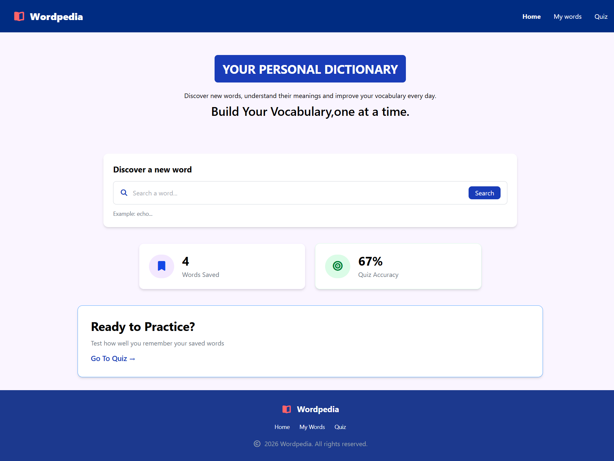
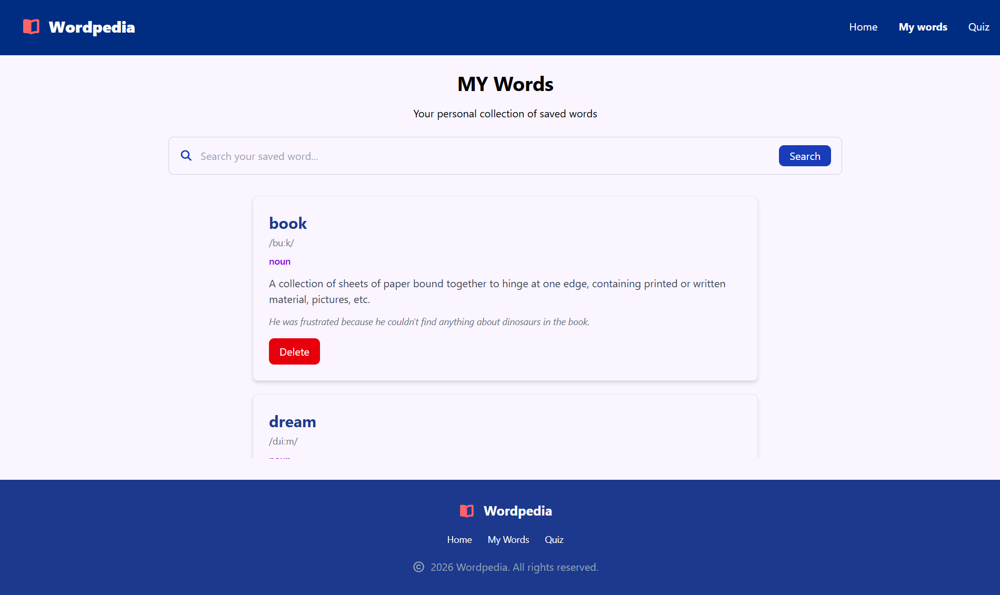
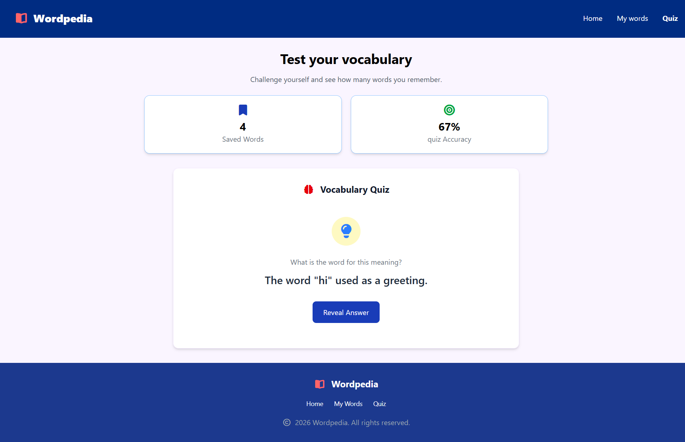

# Wordpedia – Personal Dictionary & Vocabulary Builder

Wordpedia is a personal vocabulary-building web application that helps users discover new English words, understand their meanings, listen to pronunciations, save favourite words, and test their knowledge through interactive quizzes.

## Features

 - Word Search: Search for English words and retrieve their meanings  using a Dictionary API.
 - My Words:Save and manage your favourite vocabulary.
 - Search Saved Words: Find specific words from your saved collection.
 - Quiz Mode:Test your vocabulary knowledge using saved words.
 - Quiz Statistics: Track quiz attempts, correct answers, and accuracy.
 - LocalStorage: Persist saved words and quiz statistics across browser sessions.
- Responsive Design: Adapt the interface to mobile, tablet, and desktop screens.

## Technologies Used

- HTML5
- Tailwind CSS
- JavaScript (Vanilla JS)
- Dictionary API
- Browser LocalStorage
- Font Awesome

## Pages

1. **Home:** Search words, view meanings and vocabulary statistics.
2. **My Words:** View, search and manage saved vocabulary.
3. **Quiz:** Practise saved words and track quiz performance.

## API

This project uses the Free Dictionary API:

https://api.dictionaryapi.dev/api/v2/entries/en/

## How to Run-
1. Clone the repository:
   git clone https://github.com/beherakiran/wordpedia.git

2. Open the project folder.
3. Open `index.html` in your browser.

No backend installation is required.

## Live Demo 
[Visit Wordpedia](https://wordpedia-coral.vercel.app/)

## Screenshots

### Home Page

### My Words

### Quiz

## What I Learned

- Working with external APIs using JavaScript.
- DOM manipulation and event handling.
- Using LocalStorage for persistent data.
- Implementing search and filtering functionality.
- Building interactive quiz logic.
- Tracking quiz performance and accuracy.
- Creating responsive layouts using Tailwind CSS.
